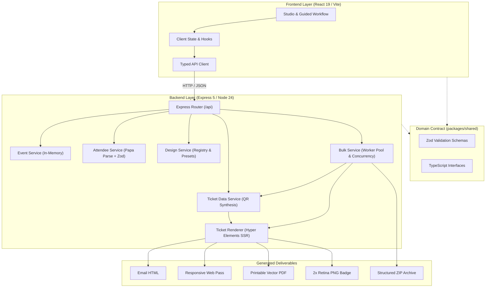
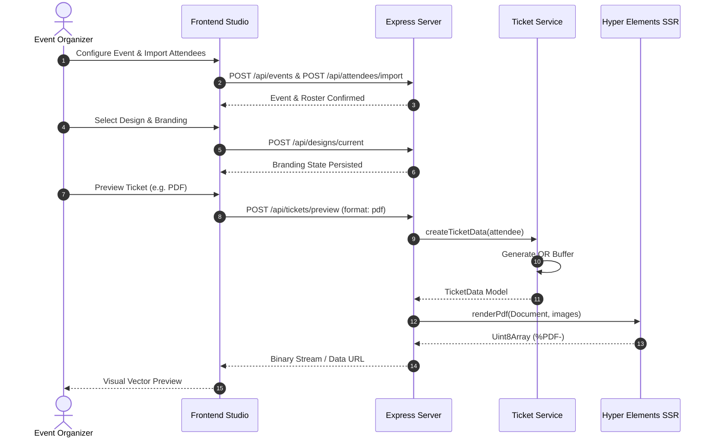
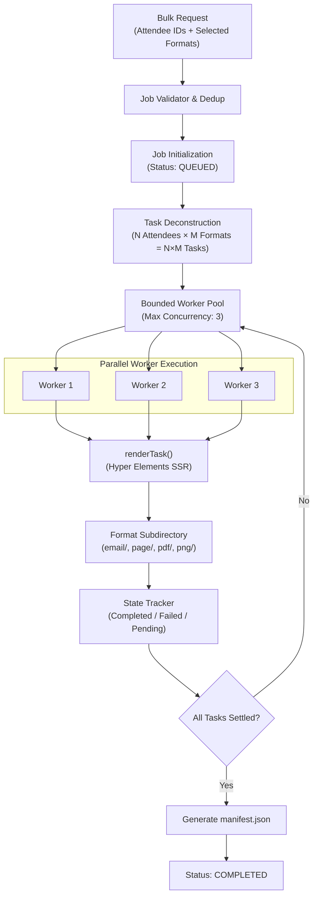

# PassForge Architecture Specification

This document details the engineering design, component architecture, rendering pipeline, and concurrency model of **PassForge**.

---

## 1. System Overview

PassForge is a monorepo application designed to synthesize and export personalized event tickets in four distinct media formats from a single typed data model. The system operates as a decoupled client-server architecture:

- **Frontend:** A React 19 Single Page Application (SPA) offering an interactive 4-step workflow for event setup, CSV attendee onboarding, ticket customization, and batch export.
- **Backend:** An Express 5 Node.js service executing ticket data synthesis, QR matrix encoding, Hyper Elements Server-Side Rendering (SSR), and bounded background bulk generation.
- **Shared Domain Contract:** A shared TypeScript workspace defining universal schemas (Zod) and interface types shared by both client and server with zero runtime overhead.

---

## 2. Architecture Principles

1. **Single Source of Truth:** A unified TypeScript data structure (`TicketData`) feeds all output formats. No format maintains separate business logic.
2. **Declarative Rendering:** Layouts are authored as idiomatic React components using `@hyper-elements/react` primitives.
3. **Failure Isolation:** In bulk batch processing, errors in individual attendee records or format renders do not fail the parent job.
4. **Bounded Resource Consumption:** Concurrency is strictly clamped to avoid CPU and memory saturation during intensive graphics rendering.
5. **Zero External Infrastructure Dependency:** Core ticket generation functions in-memory without mandatory database, Redis, or cloud storage requirements.

---

## 3. High-Level System Architecture

The following diagram illustrates the interaction between system layers:



---

## 4. Frontend Architecture

The frontend is structured around feature-driven modules under `apps/frontend/src`:

- **Workflow Orchestration (`App.tsx`):** Maintains the high-level 4-step wizard state (`event` → `attendees` → `design` → `export`). Navigation forwards and backwards preserves in-memory state.
- **Feature Modules:**
  - `features/event`: Event setup form with strict field validation.
  - `features/attendees`: CSV upload, column auto-mapping, attendee roster directory, and parsing diagnostics.
  - `features/tickets`: Design gallery selector, Brand Kit inspector (accent colors, font presets, logo upload, watermark controls), and `LiveCanvas` multi-format previewer.
  - `features/exports`: Bulk generation progress modal, real-time status polling, and one-click ZIP download trigger.
- **Custom Hooks:** Decouple view components from network requests and state management (`useEvent`, `useAttendees`, `useDesignSystem`, `useTicketRender`).

---

## 5. Backend Architecture

The backend operates as an Express 5 application divided into modular services (`apps/backend/src/modules/`):

- **Event Module (`event.service.ts`):** Manages current active event configuration, timestamps, venue details, and sample event presets.
- **Attendee Module (`attendee.service.ts`):** Handles CSV file uploads, header mapping, row validation, duplicate email filtering, and in-memory roster storage.
- **Design Module (`design.service.ts`):** Maintains the active design theme (`tech` vs `editorial`), typography presets, accent colors, and base64 logo buffers.
- **Ticket Module (`ticket.service.ts`):** Synthesizes attendee data and event metadata into a complete `TicketData` model, generating dynamic scannable QR code buffers.
- **Bulk Module (`bulk.service.ts`):** Orchestrates background batch generation, concurrency bounding, progress calculation, and ZIP streaming.

---

## 6. Shared Package and Validation

Located in `packages/shared`, this module ensures strict type safety across boundaries:

- **Runtime Validation:** Schemas built with **Zod** validate payloads before execution:
  - `eventSchema`: Validates event name, date, venue, and optional branding fields.
  - `attendeeSchema`: Enforces valid names, RFC 5322 emails, ticket categories, and optional seat identifiers.
  - `bulkJobCreateSchema`: Validates attendee ID arrays and supported output formats.
- **Zero-Dependency Contracts:** The package has no dependencies on Node.js internals or DOM APIs, allowing direct import in both Vite and Express.

---

## 7. Event Data Flow



---

## 8. CSV Import and Attendee Validation

1. **Ingestion:** Files are uploaded via multipart form data (`multer`) or raw string payloads.
2. **Parsing:** Parsed via **Papa Parse** with header row detection and whitespace trimming.
3. **Fuzzy Column Auto-Detection:** Automatically matches common column name aliases:
   - *Name:* `Name`, `Full Name`, `Attendee Name`, `Attendee`
   - *Email:* `Email`, `Email Address`, `Mail`
   - *Category:* `Ticket Type`, `Category`, `Tier`, `Pass`
   - *Seat:* `Seat`, `Seat Number`, `Desk`
4. **Row-Level Validation:** Each row is validated against `attendeeSchema`. Errors (missing names, invalid email formats) are captured into an error collection with row indices.
5. **Deduplication:** A case-insensitive email set detects duplicates within the batch.
6. **Graceful Degradation:** Valid rows are accepted and stored; invalid rows are reported back to the user without failing the entire import.

---

## 9. Ticket Design and Branding Architecture

PassForge maintains a central **Design Registry** (`templates/designs/registry.ts`) registering each design theme:

- **Cyber Tech (`tech`):** Dark navy palette (`#0a0e17`), monospaced technical typography, cyan/neon accents, and terminal metadata styling.
- **Premium Editorial (`editorial`):** Warm parchment palette (`#faf8f5`), serif typography (`Georgia, Times`), terracotta accents, and classic bordered ticket styling.

Each theme exposes the four required Hyper Elements component roots:
```
templates.email    --> Email template component
templates.page     --> Responsive page template component
templates.document --> PDF document template component
templates.canvas   --> Image canvas template component
```

Branding overrides (accent color, font family, uploaded logo, and watermark opacity) are injected into templates via props, guaranteeing visual parity across all templates.

---

## 10. Hyper Elements Rendering Architecture

Rendering is orchestrated through `apps/backend/src/services/rendering/ticketRenderer.service.ts`:

- **HTML Generation (`render`):**
  - Invokes `render(<Email ticket={t} branding={b} />)` to output client-safe HTML tables with inline styles.
  - Invokes `render(<Page ticket={t} branding={b} />)` to output a full responsive HTML page with mobile breakpoints.
- **PDF Generation (`renderPdf`):**
  - Invokes `renderPdf(<Document ticket={t} branding={b} />)` from `@hyper-elements/react/pdf`.
  - Injects binary image maps (QR codes, logos, watermark overlays) into the rendering context.
- **PNG Generation (`renderImage`):**
  - Invokes `renderImage(<Canvas ticket={t} branding={b} />)` from `@hyper-elements/react/image`.
  - Configured with `scale: 2` (retina output) and pre-loaded TrueType fonts (`Arial`, `Courier New`, `Georgia`, `Trebuchet MS`, `Times New Roman`) for consistent server-side font rasterization.

---

## 11. Bulk Generation Architecture

Bulk generation transforms an array of attendees and selected formats into individual render tasks managed by `BulkService`.



---

## 12. Worker Pool and Bounded Concurrency

To ensure stability under load:

- **Configured Concurrency:** Default worker pool is bounded to **3 parallel workers** (`this.concurrency = 3`).
- **Memory Protection:** Rendering PDFs and rasterizing 2x Retina PNGs via Cairo/Pango is memory-intensive. Bounding concurrency prevents out-of-memory (OOM) crashes on constrained host instances.
- **Task Scheduling:** When a job is initiated, worker promises pull tasks from a shared index pointer until the pending queue is exhausted.

---

## 13. Progress Tracking and Failure Isolation

- **Per-Task Isolation:** Each attendee-format render is wrapped in an independent `try/catch` boundary. If attendee #4's PNG fails due to an image decoding error, attendee #4's PDF and all other attendee tickets proceed normally.
- **Atomic Progress Counters:** Every task completion or failure immediately updates `completedTasks`, `failedTasks`, and `progressPercent`.
- **Status Classification:**
  - `QUEUED`: Enqueued, awaiting worker pickup.
  - `PROCESSING`: Workers actively rendering tasks.
  - `COMPLETED`: 100% of tasks finished with 0 errors.
  - `COMPLETED_WITH_ERRORS`: All tasks finished; at least 1 task failed.
  - `CANCELLED`: Aborted by organizer; pending tasks terminated.

---

## 14. Selective Retry Mechanism

When a job reaches `COMPLETED_WITH_ERRORS`:

1. The organizer triggers `POST /api/bulk/jobs/:jobId/retry`.
2. The service filters tasks where `status === 'FAILED'`.
3. Only the failed tasks are reset to `PENDING`; completed tasks remain untouched on disk.
4. The worker pool is re-invoked on the subset of failed tasks.
5. Progress continues from the previous successful count.

---

## 15. ZIP Generation and Manifest

When `GET /api/bulk/jobs/:jobId/download` is requested:

1. **Format-Segmented Folder Structure:**
   ```
   passforge-tickets-[jobId].zip
   ├── email/
   │   ├── alex-morgan-att-001.html
   │   └── sam-rivera-att-002.html
   ├── pdf/
   │   ├── alex-morgan-att-001.pdf
   │   └── sam-rivera-att-002.pdf
   ├── png/
   │   ├── alex-morgan-att-001.png
   │   └── sam-rivera-att-002.png
   └── manifest.json
   ```
2. **Zero-PII Manifest (`manifest.json`):** Contains event metadata, total requested vs successful outputs, format lists, file names, and byte sizes. Attendee names and emails are omitted from manifest indices for privacy.
3. **HTTP Streaming:** The ZIP archive is streamed directly to the client via `archiver`, avoiding buffering the entire ZIP into server memory.

---

## 16. Temporary File Management and Cleanup

- **Job Retention Window:** Output folders are retained for **2 hours** (`JOB_RETENTION_MS`) after job completion.
- **Periodic Cleaner:** A background timer runs every 15 minutes checking for expired job directories and evicting their memory entries.
- **Startup Sweep:** When the backend boots, `cleanupOrphanedDirs()` scans the output directory and purges leftover `bulk_*` directories from previous server runs.
- **Safe Isolation:** Cleanup logic strictly checks directory name prefixes (`bulk_`) to prevent accidental deletion of unrelated files.

---

## 17. API Communication

Communication between frontend and backend uses JSON over HTTP:

- Polling routes (e.g. `GET /api/bulk/jobs/:jobId`) are excluded from aggressive rate-limiting to allow smooth progress bar updates.
- File uploads use standard `multipart/form-data`.
- Preview routes stream raw binary data with proper MIME types (`application/pdf`, `image/png`, `text/html`).

---

## 18. Security and Resource Safeguards

- **File Size Limits:** CSV uploads are strictly capped at 5MB via `multer`.
- **Roster Bounds:** CSV row count is capped at 500 attendees (`MAX_CSV_ROWS`) to ensure deterministic performance in shared demo environments.
- **Path Traversal Protection:** Filenames are sanitized via `sanitizeFilename()` using regex whitelists (`[a-z0-9_-]`), preventing directory traversal attacks.
- **Direct Output Blocking:** Access to `/output` routes is blocked with a 404 handler; all files must be accessed through validated controller endpoints.
- **Rate Limiting:** Express rate-limiting guards all general API routes against denial-of-service attempts.

---

## 19. Architectural Trade-offs

| Decision | Advantage | Trade-off |
|---|---|---|
| **In-Memory Job Store** | Zero configuration; runs anywhere without databases, Redis, or external brokers. | State does not persist across server process restarts. |
| **Local TrueType Font Bundling** | Renders 100% offline without external Google Fonts network calls; reproducible rasterization. | Increases backend assets directory size by ~4MB. |
| **Streaming ZIP Archive** | Low memory footprint; begins downloading immediately without full disk buffering. | Cannot report exact total ZIP size header (`Content-Length`) prior to streaming. |
| **Client-Driven Polling** | Standard HTTP implementation; robust across reverse proxies and firewalls without WebSocket complexity. | Incurs minor polling overhead compared to server-sent events (SSE). |

---

## 20. Current Limitations and Future Improvements

- **Database Adapter Layer:** While the current in-memory store is optimal for standalone demonstrations, production multi-user environments can implement persistent database adapters (e.g., PostgreSQL / Prisma) matching the existing repository interfaces.
- **Distributed Queue Integration:** The bounded worker pool can be backed by Redis / BullMQ if horizontal auto-scaling across multiple server instances is required.
- **Barcode & NFC Passes:** Future extensions can generate PKPass bundles for Apple Wallet and Google Wallet alongside the existing four formats.
