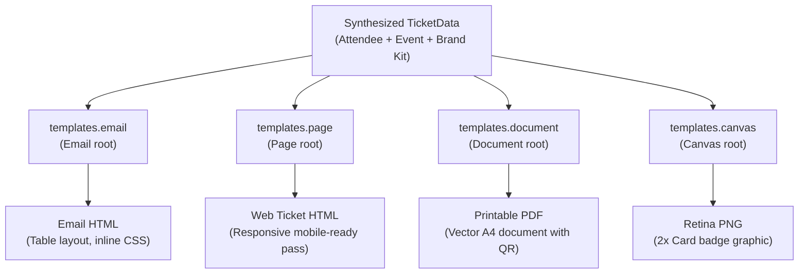

# Hyper Elements Integration Guide

This document explains how **PassForge** integrates `@hyper-elements/react` as its core multi-format rendering engine, detailing component trees, compilation pipelines, and best practices for creating new ticket templates.

---

## 1. Why Hyper Elements Was Selected

Generating tickets across modern distribution channels typically requires managing four disparate technologies:
- **Email:** Table-based HTML with inline CSS compatible with Outlook and Gmail.
- **Web:** Responsive modern HTML with flexbox and CSS media queries.
- **PDF:** A vector document compiler (e.g. headless Chrome, Puppeteer, or LaTeX).
- **PNG:** A 2D graphics canvas renderer.

Maintaining four disjoint template codebases for every ticket design leads to visual drift, styling bugs, and quadrupled engineering overhead.

**Hyper Elements** solves this fundamental problem. It allows developers to author declarative ticket designs once using React components (`<Email>`, `<Page>`, `<Document>`, `<Canvas>`), compiling each into its respective medium while preserving pixel-level design fidelity and typographic hierarchy.

---

## 2. Role in PassForge: Multi-Format Compiler

PassForge separates business logic from document compilation:

- **What PassForge Handles:** Event metadata management, CSV roster ingestion, fuzzy column detection, Zod validation, QR code matrix generation, branding state management, and the background concurrent worker queue.
- **What Hyper Elements Handles:** Server-Side Rendering (SSR) of typed React component trees into client-safe HTML tables, responsive web pages, vector PDF streams, and 2x Retina PNG buffers.

> **Note for Organizers:** Event organizers never interact with React, JSX, or code. Organizers customize designs visually through the PassForge Studio UI (accent pickers, font selectors, logo uploaders). PassForge translates these settings into typed props and feeds them to Hyper Elements behind the scenes.

---

## 3. Shared Ticket Architecture

Every ticket design in PassForge implements a standard interface consuming two typed domain objects:

```tsx
interface TicketTemplateProps {
  ticket: TicketData;       // Attendee name, seat, ticket tier, QR code data URL
  branding: BrandingConfig; // Accent color, font family, logo buffer, watermark settings
}
```

Each registered design (such as `tech` or `editorial`) exports four root components:
- `Email`: Rooted in `<Email>` from `@hyper-elements/react`.
- `Page`: Rooted in `<Page>` from `@hyper-elements/react`.
- `Document`: Rooted in `<Document>` from `@hyper-elements/react`.
- `Canvas`: Rooted in `<Canvas>` from `@hyper-elements/react`.

---

## 4. Rendering Pipeline

The following diagram illustrates how PassForge routes a single ticket into the four Hyper Elements rendering functions:



---

## 5. Actual API Integration

In `apps/backend/src/services/rendering/ticketRenderer.service.ts`, PassForge invokes the verified Hyper Elements API methods:

### 1. HTML Rendering (`render`)
Used for both Email and Web Page outputs:

```tsx
import { render } from '@hyper-elements/react';

// Email HTML (generates table-based layout with inline styles)
const { html: emailHtml } = await render(
  React.createElement(templates.email, { ticket, branding })
);

// Responsive Web HTML (generates HTML document with mobile breakpoints)
const { html: pageHtml } = await render(
  React.createElement(templates.page, { ticket, branding })
);
```

### 2. PDF Rendering (`renderPdf`)
Used for printable tickets and badges:

```tsx
import { renderPdf } from '@hyper-elements/react/pdf';

// Injects binary image maps (QR codes, logos, watermark overlays)
const { pdf } = await renderPdf(
  React.createElement(templates.document, { ticket, branding }),
  { images: imageMap }
);
```

### 3. Image Rendering (`renderImage`)
Used for digital badge cards and wallet graphics:

```tsx
import { renderImage } from '@hyper-elements/react/image';

const { image } = await renderImage(
  React.createElement(templates.canvas, { ticket, branding }),
  {
    format: 'png',
    scale: 2, // 2x Retina resolution
    fonts: cachedFonts, // Preloaded local TrueType fonts
    images: imageMap,
  }
);
```

---

## 6. Output Formats Comparison

| Property | Email (`<Email>`) | Web Page (`<Page>`) | PDF (`<Document>`) | Canvas (`<Canvas>`) |
|---|---|---|---|---|
| **Root Primitive** | `<Email width={600}>` | `<Page width={640}>` | `<Document>` | `<Canvas width={720} height={320}>` |
| **Compiler Function** | `render()` | `render()` | `renderPdf()` | `renderImage()` |
| **Output Type** | UTF-8 String (HTML) | UTF-8 String (HTML) | `Uint8Array` (Binary `%PDF-`) | `Uint8Array` (Binary `\x89PNG`) |
| **Responsive Behavior** | Stacks columns on mobile | `breakpoints={{ mobile: 560 }}` | Fixed print media margins | Fixed pixel dimensions |
| **Image Resolution** | Screen DPI | Screen DPI | Vector / 300 DPI | 2x Retina (1440×640 px) |
| **Typical Target** | SMTP / SendGrid / SES | Mobile Web Check-in | A4 / Badge Printers | Digital Wallet / Apple Photos |

---

## 7. How Visual Consistency Is Maintained

To guarantee that a ticket looks identical across all four formats, PassForge follows strict layout conventions:

1. **Shared Color Tokens:** The active accent color (`branding.accentColor`) is applied to borders, badges, tier labels, and callouts across all four roots.
2. **Deterministic Font Bundling:** The backend bundles physical TrueType font files (`arial.ttf`, `cour.ttf`, `georgia.ttf`, `trebuc.ttf`, `times.ttf`). When `renderImage` and `renderPdf` execute, fonts are read from local memory buffers, eliminating missing glyphs or cross-platform rasterization variations.
3. **Centered Logo Watermarks:** The organizer's uploaded logo is processed into a scaled, opacity-reduced SVG overlay (`preserveAspectRatio="xMidYMid meet"`) and rendered into the background behind text and QR elements.
4. **No Raw HTML Elements:** Templates use Hyper Elements semantic primitives (`Heading`, `Text`, `Span`, `Column`, `Row`) rather than raw `<div>` or `<p>` tags, ensuring consistent cross-compilation.

---

## 8. Error Handling and Diagnostics

Hyper Elements returns a `diagnostics` array alongside rendered outputs. PassForge monitors these diagnostics:

- **Fatal Errors:** Syntax or hierarchy errors throw `ElementsError`. These are caught by PassForge's per-task error boundary, recorded on the task record (`task.status = 'FAILED'`), and isolated so other tickets continue rendering.
- **Non-Fatal Warnings:** Formatting or sizing warnings are passed through in `renderResult.diagnostics` for debugging.

---

## 9. Creating a New Ticket Template

To add a new ticket theme to PassForge:

1. Create a directory under `apps/backend/src/templates/designs/[theme-name]/`.
2. Implement the four required components:
   - `[Theme]Email.tsx` (Rooted in `<Email>`)
   - `[Theme]Page.tsx` (Rooted in `<Page>`)
   - `[Theme]Document.tsx` (Rooted in `<Document>`)
   - `[Theme]Canvas.tsx` (Rooted in `<Canvas>`)
3. Register the new theme in `apps/backend/src/templates/designs/registry.ts`:
   ```typescript
   export const DESIGNS_REGISTRY: Record<TicketDesignId, DesignMetadata> = {
     // ...
     [newThemeId]: {
       id: newThemeId,
       name: 'My New Theme',
       description: 'Theme description',
       templates: {
         email: MyThemeEmail,
         page: MyThemePage,
         document: MyThemeDocument,
         canvas: MyThemeCanvas,
       },
     },
   };
   ```
4. Run `npm test` to verify that all four formats compile and pass magic-byte verification.
