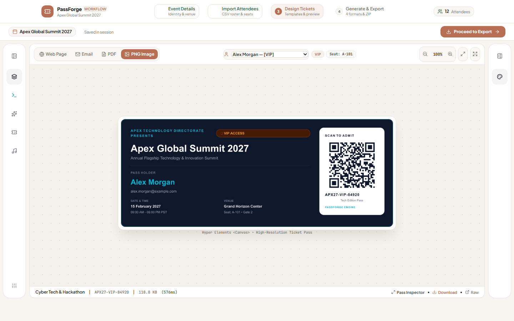
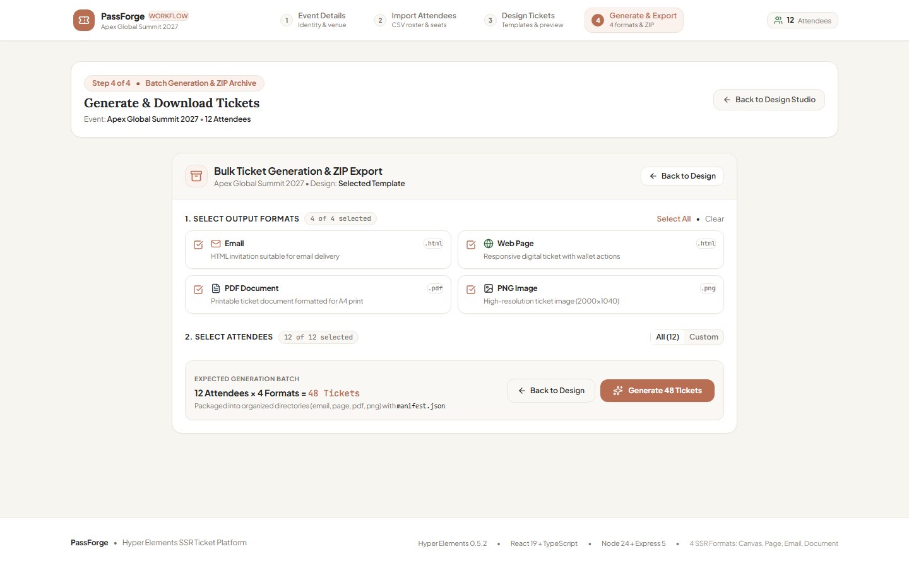

# PassForge

> "One event. Hundreds of tickets. Every one personal."

PassForge is a modern event ticketing engine and design studio. It helps event organizers transform attendee spreadsheets into beautiful, personalized tickets across four distinct production formats—eliminating the tedious, error-prone manual work of traditional ticket generation.

---

## Project Preview

*A single typed ticket model compiling seamlessly into Canvas Badge PNG, Responsive Web Pass, Email HTML, and Vector PDF formats via Hyper Elements.*

  
  

*Left: The interactive Ticket Design Studio with real-time live preview and branding controls. Right: High-throughput bounded background bulk generation with format-organized ZIP exports.*

---

## The Problem

Event organizers commonly manage attendee rosters using simple spreadsheets or CSV exports from registration forms. However, when it comes to generating and distributing admission passes:

- **Manual customization is tedious:** Merging attendee names, categories, and seat numbers into design software requires repetitive export workflows.
- **Multi-format fragmentation:** Organizers need email invitations for confirmation, responsive web passes for mobile check-in, printable PDFs for badge printing, and high-resolution images for digital wallets. Maintaining four separate designs leads to brand inconsistency and formatting errors.
- **Export bottlenecks:** Batch processing hundreds of tickets often freezes local computers or fails mid-way with no way to isolate failed records or retry selectively.

---

## The Solution

PassForge simplifies event ticket creation into a guided four-step workflow:

1. **Event Details:** Define event title, date, time, venue, and organizer identity.
2. **Import Attendees:** Upload rosters via CSV with automatic column detection, row-level validation, and duplicate email filtering.
3. **Design Tickets:** Choose between distinct architectural themes (*Cyber Tech*, *Premium Editorial*, *Vintage Cinema*, and *Neon Festival*), customize color palettes and typography, upload an organizer logo, and configure an opacity watermark.
4. **Generate & Export:** Live-preview tickets across all four formats, or trigger a background bulk generation job to package all tickets into an organized, zero-PII ZIP archive.

---

## Four Output Formats

Every ticket is rendered through unified Server-Side Rendering (SSR) into four specialized formats tailored for real-world event distribution:

| Format | Technical Root | Description | Practical Use Case |
|---|---|---|---|
| **Email Invite** | `<Email>` | Email-ready HTML with table layout and inline CSS | Exportable for dispatch via external email services or SMTP |
| **Web Pass** | `<Page>` | Standalone responsive HTML document with mobile viewport scaling | Direct digital admission pass accessible via mobile browser |
| **Print PDF** | `<Document>` | Vector A4/Letter PDF with scannable QR matrices | Physical attendee badges and print-at-home admission passes |
| **Canvas Badge** | `<Canvas>` | High-resolution 2x Retina PNG card graphic | Digital wallet storage, social sharing, and graphic badges |

---

## Key Features

- **Robust CSV Ingestion:** Drag-and-drop file upload with raw CSV paste fallback.
- **Intelligent Column Mapping:** Automatically detects and maps columns for Name, Email, Ticket Tier, and Seat Number.
- **Attendee Validation:** Enforces RFC 5322 email syntax, detects duplicates, and isolates row-level errors without rejecting the entire file.
- **Multiple Ticket Design Templates:** Switch seamlessly between curated architectural themes including *Cyber Tech* (dark terminal aesthetic), *Premium Editorial* (warm parchment gala aesthetic), *Vintage Cinema* (authentic perforated tear-off stub), and *Neon Festival* (high-energy concert pass with badge accents).
- **Brand Kit Customization:** Real-time accent color picker, five typography presets, and optional logo watermark with preserve-aspect-ratio scaling and opacity control.
- **Live Ticket Preview:** Instant browser preview across all four formats, desktop/mobile viewport toggle, and attendee selector.
- **High-Throughput Bulk Generation:** Asynchronous background worker queue with bounded concurrency (3 concurrent workers).
- **Failure Isolation & Selective Retry:** Per-ticket error boundaries ensure one malformed record cannot abort the batch; retry only failed outputs with zero re-rendering of completed tickets.
- **Structured ZIP Export:** Automatically organizes completed files into clean format subdirectories (`email/`, `page/`, `pdf/`, `png/`) alongside a privacy-preserving `manifest.json`.
- **Public Demo Safeguards:** Upload limits capped at 5MB and 500 rows, rate-limiting protection, and automatic orphaned directory cleanup.

---

## How Hyper Elements Powers PassForge

### For Non-Technical Readers
PassForge uses a shared React-based ticket design system powered by **Hyper Elements**. Instead of creating and maintaining four completely separate templates (an HTML email template, a web page, a PDF generation script, and a graphic canvas), organizers select one design and PassForge automatically renders it across email, web, PDF, and image badge formats. This maintains visual consistency while saving hours of design coordination.

### For Technical Readers
Hyper Elements (`@hyper-elements/react`) acts as the unified multi-format compiler in PassForge:
- **`render()`**: Compiles `<Email>` into email-safe table HTML and `<Page>` into responsive HTML web documents.
- **`renderPdf()`**: Compiles `<Document>` into vector PDF binary buffers using `@hyper-elements/react/pdf`.
- **`renderImage()`**: Compiles `<Canvas>` into 2x Retina PNG image buffers using `@hyper-elements/react/image` and `@resvg/resvg-js`.

PassForge provides the business logic—CSV ingestion, state management, ticket data synthesis, QR matrix encoding, and the concurrent worker queue—while Hyper Elements provides the rendering primitives that translate typed React JSX trees into client-safe outputs.

For detailed architecture diagrams, component trees, and rendering benchmarks, see [docs/hyper-elements.md](docs/hyper-elements.md).

---

## Technology Stack

- **Frontend:** React 19, TypeScript, Vite, Tailwind CSS, Lucide React
- **Backend:** Node.js 24, Express 5, TypeScript (`tsx`)
- **Rendering Engine:** `@hyper-elements/react`, `@react-pdf/renderer`, `@resvg/resvg-js`, Satori, QRCode
- **Validation & Processing:** Zod, Papa Parse, Archiver
- **Monorepo Tooling:** npm workspaces, concurrently

---

## Project Limitations

- **In-Memory Storage:** Application state, attendee rosters, and bulk job tracking are stored in memory. Restarting the backend server resets state to the default sample event.
- **Single-Session Workspaces:** User accounts, multi-tenant authentication, and persistent database storage are not implemented.
- **Visual QR Identification:** QR codes encode attendee ticket identifiers for visual rendering; an on-site scanner or admission database is not included.

---

## Documentation

- [Architecture Specification](docs/architecture.md) — Comprehensive system architecture, data flow diagrams, worker pool mechanics, and design trade-offs.
- [Hyper Elements Integration Guide](docs/hyper-elements.md) — Technical deep dive into Hyper Elements integration, root components, and rendering pipeline.
- [REST API Reference](docs/api-reference.md) — Complete REST API specification with request schemas, response models, and error codes.
- [Contributing Guidelines](docs/contributing.md) — Contribution guidelines, bug reporting, and code quality standards.
