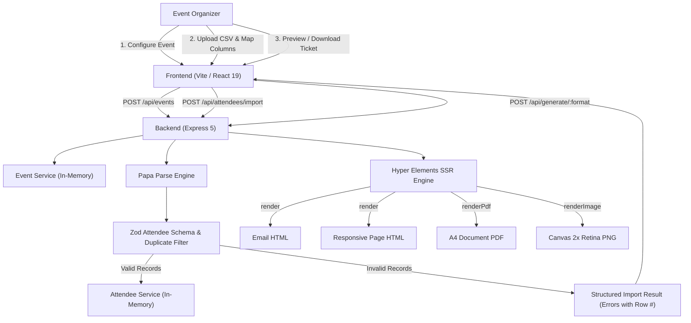

# PassForge Architecture Specification (Milestone 2)

PassForge is structured as an **npm-workspaces monorepo** separating presentation, server-side business logic, and shared TypeScript domain contracts.

```
PassForge/
├── apps/
│   ├── frontend/         # React 19 + TypeScript + Vite Single Page Application
│   └── backend/          # Node.js 24 + Express 5 + Hyper Elements 0.5.2 SSR Engine
├── packages/
│   └── shared/           # Unified TypeScript interfaces and Zod validation schemas
├── docs/                 # Architecture and development documentation
├── package.json          # Root workspace configuration and unified scripts
└── tsconfig.base.json    # Shared TypeScript compiler options
```

---

## 1. Monorepo Workspaces & Responsibilities

### `packages/shared`
- **Purpose:** Single source of truth for domain models, request/response contracts, and Zod validation schemas.
- **Key Modules:**
  - `src/types/event.ts`: `EventInfo`
  - `src/types/attendee.ts`: `AttendeeInfo`, `CsvColumnMapping`, `CsvRowError`, `CsvImportResult`
  - `src/types/ticket.ts`: `TicketData`, `OutputFormat`, `RenderResult`
  - `src/schemas/event.schema.ts`: `eventSchema`
  - `src/schemas/attendee.schema.ts`: `attendeeSchema`, `csvColumnMappingSchema`
- **Zero runtime dependency on UI or Node-only APIs**, allowing seamless sharing between Vite and Express.

### `apps/backend`
- **Purpose:** REST API server, in-memory data store, CSV parsing/validation engine, and Hyper Elements SSR ticket generator.
- **Port:** `3000`
- **Key Modules:**
  - `src/modules/event/`: In-memory event configuration service and controller.
  - `src/modules/attendee/`: Papa Parse ingestion, header auto-detection, row-by-row validation, duplicate email detection, and in-memory storage.
  - `src/modules/ticket/`: Ticket data synthesizer with dynamic QR codes.
  - `src/templates/`: Hyper Elements templates for `<Email>`, `<Page>`, `<Document>`, and `<Canvas>`.
  - `src/services/rendering/`: Core SSR rendering service using `@hyper-elements/react`, `@hyper-elements/react/pdf`, and `@hyper-elements/react/image`.
  - `src/routes/`: Express routers for `/api/health`, `/api/events`, `/api/attendees`, and `/api/tickets`.
  - `assets/fonts/`: Local TrueType fonts (`arial.ttf`, `arialbd.ttf`) for offline PDF and Canvas image rendering.

### `apps/frontend`
- **Purpose:** Modern, responsive event organizer web application shell.
- **Port:** `5173` (Proxies `/api` and `/output` to `http://localhost:3000`).
- **Key Features:**
  - **Event Management:** Real-time form to configure conference details.
  - **CSV Ingestion:** Drag-and-drop file upload, raw CSV pasting, and sample CSV download.
  - **Column Mapping:** Flexible interface mapping user CSV columns to Name, Email, Ticket Category, and Seat.
  - **Import Summary:** Metrics dashboard (valid, invalid, skipped rows) and row-level error diagnosis.
  - **Attendee Directory:** Searchable table with category filtering and ticket preview triggers.
  - **Ticket Preview:** Interactive modal displaying all 4 Hyper Elements formats with instant download links.

---

## 2. Data Flow Architecture



---

## 3. Hyper Elements SSR Pipeline

All Hyper Elements rendering is strictly isolated to the backend, ensuring zero bundle bloat in the client app:

1. **Email HTML:**
   - Template: `apps/backend/src/templates/email/TicketEmail.tsx`
   - Invocation: `render(<TicketEmail ticket={ticket} />)`
   - Engine: `@hyper-elements/react`
   - Output: Standalone HTML compatible with classic Outlook, Gmail, Apple Mail.

2. **Responsive Web Page:**
   - Template: `apps/backend/src/templates/page/TicketPage.tsx`
   - Invocation: `render(<TicketPage ticket={ticket} />)`
   - Engine: `@hyper-elements/react`
   - Output: HTML page with `@media` phone breakpoints at `560px`.

3. **Printable Document PDF:**
   - Template: `apps/backend/src/templates/document/TicketDocument.tsx`
   - Invocation: `renderPdf(<TicketDocument ticket={ticket} />, { images })`
   - Engine: `@hyper-elements/react/pdf` using `@react-pdf/renderer`
   - Output: Valid binary PDF (`%PDF-`) sized for ISO A4 with header/footer page markers.

4. **Ticket PNG Badge:**
   - Template: `apps/backend/src/templates/canvas/TicketCanvas.tsx`
   - Invocation: `renderImage(<TicketCanvas ticket={ticket} />, { format: 'png', scale: 2, fonts, images })`
   - Engine: `@hyper-elements/react/image` using `satori` and `@resvg/resvg-js`
   - Output: High resolution 2000 × 1040 PNG image buffer.
