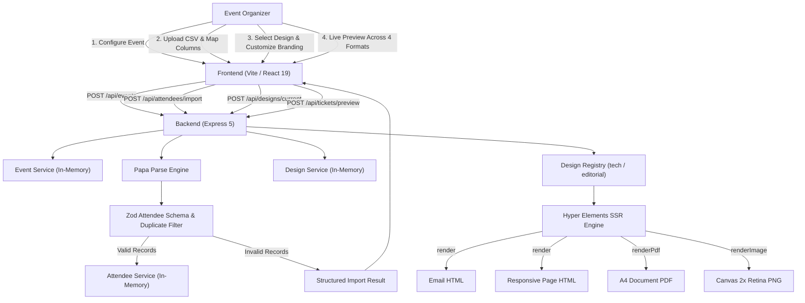

# PassForge Architecture Specification (Milestone 3)

PassForge is structured as an **npm-workspaces monorepo** separating presentation, server-side business logic, and shared TypeScript domain contracts.

```
PassForge/
├── apps/
│   ├── frontend/         # React 19 + TypeScript + Vite Single Page Application
│   └── backend/          # Node.js 24 + Express 5 + Hyper Elements 0.5.2 SSR Engine
├── packages/
│   └── shared/           # Unified TypeScript interfaces and Zod validation schemas
├── docs/                 # Architecture and development documentation
├── package.json          # Root workspace configuration and unified scripts
└── tsconfig.base.json    # Shared TypeScript compiler options
```

---

## 1. Monorepo Workspaces & Responsibilities

### `packages/shared`
- **Purpose:** Single source of truth for domain models, request/response contracts, and Zod validation schemas.
- **Key Modules:**
  - `src/types/event.ts`: `EventInfo`
  - `src/types/attendee.ts`: `AttendeeInfo`, `CsvColumnMapping`, `CsvRowError`, `CsvImportResult`
  - `src/types/ticket.ts`: `TicketData`, `OutputFormat`, `RenderResult`
  - `src/types/design.ts`: `TicketDesignId`, `DesignMetadata`, `BrandingConfig`, `DesignConfig`, `TicketPreviewRequest`, `TicketPreviewResponse`
  - `src/schemas/event.schema.ts`: `eventSchema`
  - `src/schemas/attendee.schema.ts`: `attendeeSchema`, `csvColumnMappingSchema`
  - `src/schemas/design.schema.ts`: `brandingConfigSchema`, `designConfigSchema`, `ticketPreviewRequestSchema`
- **Zero runtime dependency on UI or Node-only APIs**, allowing seamless sharing between Vite and Express.

### `apps/backend`
- **Purpose:** REST API server, in-memory data store, CSV parsing/validation engine, and Hyper Elements SSR ticket generator.
- **Port:** `3000`
- **Key Modules:**
  - `src/modules/event/`: In-memory event configuration service and controller.
  - `src/modules/attendee/`: Papa Parse ingestion, header auto-detection, row-by-row validation, duplicate email detection, and in-memory storage.
  - `src/modules/ticket/`: Ticket data synthesizer with dynamic QR codes.
  - `src/modules/design/`: Design configuration service & controller holding active template and branding state in-memory.
  - `src/templates/designs/`:
    - `tech/`: Cyber Tech / Hackathon theme templates (`TechEmail`, `TechPage`, `TechDocument`, `TechCanvas`).
    - `editorial/`: Premium Editorial Gala theme templates (`EditorialEmail`, `EditorialPage`, `EditorialDocument`, `EditorialCanvas`).
    - `registry.ts`: Central registry mapping design IDs to metadata and template component trees.
  - `src/services/rendering/`: Unified SSR rendering service supporting design layouts, branding propagation, and custom logo image buffers.
  - `src/routes/`: Express routers for `/api/health`, `/api/events`, `/api/attendees`, `/api/designs`, `/api/branding`, and `/api/tickets`.
  - `assets/fonts/`: Local TrueType fonts (`arial.ttf`, `arialbd.ttf`) for offline PDF and Canvas image rendering.

### `apps/frontend`
- **Purpose:** Modern, responsive event organizer web application shell.
- **Port:** `5173` (Proxies `/api` and `/output` to `http://localhost:3000`).
- **Key Features:**
  - **Event Management:** Real-time form to configure conference details.
  - **CSV Ingestion:** Drag-and-drop file upload, raw CSV pasting, and sample CSV download.
  - **Column Mapping:** Flexible interface mapping user CSV columns to Name, Email, Ticket Category, and Seat.
  - **Import Summary:** Metrics dashboard (valid, invalid, skipped rows) and row-level error diagnosis.
  - **Attendee Directory:** Searchable table with category filtering and ticket preview triggers.
  - **Ticket Designer & Live Preview:**
    - Visual layout selector (Tech vs Editorial).
    - Branding controls (accent color palette swatches, custom hex picker, optional event logo upload, reset defaults).
    - Live 4-format preview toolbar with mobile/desktop viewport toggle and attendee switcher.
    - Real-time rendered previews for Canvas PNG, Responsive Page, Email HTML, and Vector PDF.
    - Persistent design configuration saved to backend state.

---

## 2. Data Flow Architecture


